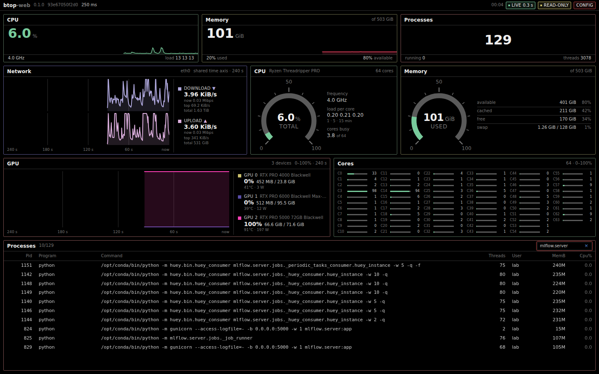
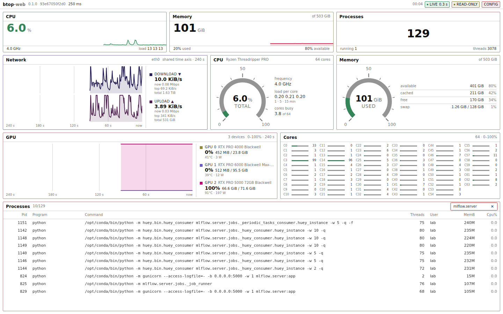

# btop-web

btop-web serves [btop](https://github.com/aristocratos/btop) 1.3.0's system telemetry to a web browser. It reads the same `/proc`, `/sys` and device interfaces as btop and draws the result as one page, on a desktop or a phone.

Status: 2026-10-28. The collectors are implemented, and a live comparison matches btop 1.3.0 on the sampled metrics. Inside a container the page shows only that container. The page follows the chosen design `docs/design/concepts/05.06-network-paired.html`, with a GPU load plot in the third band. 242 tests pass. No release is tagged yet.



*Fig 1 - The shipped page on a live host with three GPUs at 1440x900, theme 0 Default, dark, after 90 s of history. The process table is filtered to `mlflow.server`, so it shows only the host's MLflow service processes.*



*Fig 2 - The same page and host in light.*

## Contents

- [1. Overview](#1.-Overview)
- [2. Quick start](#2.-Quick-start)
- [3. Configuration](#3.-Configuration)
- [4. Endpoints](#4.-Endpoints)
- [5. Design](#5.-Design)
- [6. How it works](#6.-How-it-works)
- [7. Development](#7.-Development)
- [8. Tests](#8.-Tests)
- [9. Repository layout](#9.-Repository-layout)
- [10. Exposure](#10.-Exposure)
- [11. Licence and attribution](#11.-Licence-and-attribution)

## 1. Overview

This section states what btop-web is and the rules it holds to. btop-web is a web port of btop. On a host, every value uses btop's source, formula, units, rounding and field name. A value the host cannot provide is drawn as unavailable, never as zero.

Inside a container, btop-web shows only that container, and this rule outranks btop parity there (`ACC-SCOPE-64-CONTAINER`, ordered by the owner on 2026-10-27). CPU, memory and swap come from the container's cgroup v2 files, the processes are the members of its cgroup, and the network is its own network namespace. The cores are the CPUs in the container's cpuset, each with btop's per-core usage, and the GPUs are the devices passed into the container, read as on a host. The load average is the container's own (`DEF-CPU-44-CONTAINER-LOAD`): every 15 s btop-web counts the container's running and uninterruptible tasks and averages the count with the kernel's own formula, and `load per core` divides it by the container's effective CPUs. CPU frequency and temperature and disk IO activity have no container-scoped source, so they read `unavailable` or are not drawn; the page never shows the host value in their place. A CONTAINER chip in the top bar names the runtime, the detection signal and the cgroup. Outside a container nothing changes.

- One sampler tick per interval, shared by every connected client, so a second browser adds no collection cost
- The default interval is 250 ms, where btop's is 2000 ms; `update_ms` and `-u` override it
- Charts are SVG paths built on the server from sample buffers: each series is exponentially smoothed with a 1 s time constant, then interpolated with PCHIP; every printed number except the per-core values and the derived `load per core` and `cores busy` stays btop's raw value
- The CPU and memory gauge arcs draw the same 1 s average as the plots, so an arc steps about a third as far per update while the number inside it stays btop's raw value
- Every plot except the process-row CPU graphs has a very faint quarter grid under its lines; once a plot's 240 s window is full, its line starts at a vertex the previous frame already drew, so the left end of the line does not change height every frame
- The network scale follows btop's auto scale, counted over btop's 10 s span at any interval (5 samples at 2000 ms, 40 at 250 ms), and never shows less than 1 MiB/s; a new scale is reached over 1 s or more. The Processes count graph reaches a new ceiling the same way; these scale changes are the only animation on the page. The panel shows the busiest interface other than `lo`, and `lo` only when no other interface exists
- Five numbered theme options - 0 Default, then Everforest Medium, Flexoki, Gruvbox and Solarized - each with light and dark variants, selected at runtime and persisted. Theme 0 Default takes its surfaces from the JupyterLab Steel themes, a `#272b31` page in dark and the JupyterLab light theme's white page in light, with muted Steel panel borders, a steel-blue download line and a muted amber upload line in place of btop's two violets (`ACC-GRAPH-72-NET-COLOURS`)
- The mode is dark, light or auto; auto is the default and follows the system light or dark setting, also when it changes while the page is open
- Read-only by default: the server refuses every mutating request with 403, and the page states the mode; with `--no-readonly` the config menu changes btop's server options for every viewer and writes them to the `-c` file
- All GPUs are shown by default, including this workstation's three NVIDIA devices, as lines in one GPU load plot with a legend entry per GPU; the device selection persists; AMD support is compiled with `FEATURES=rocm` and needs `librocm_smi64`
- Each process row with CPU above 0 draws a line of its last 20 s left of Cpu%, in the Cpu% colour, under btop's `proc_cpu_graphs` rules; the line goes after 10 updates below 0.1 %
- The process list has three views, chosen per viewer in the config menu: `top` lists pid 1 and every top-level process, each collapsed with its own plus all its descendants' CPU, memory and threads; `all` lists every process flat with its own values; `tree` indents each process under its parent as btop's tree does, with a triangle on each parent row that collapses or expands that row, and a config option that sets every node collapsed or expanded. A viewer with no stored choice starts in the view `--proc-view` names, else in `tree` when btop's `proc_tree` is True, else in `top`
- A click on a process column header sorts by that column and a second click reverses the order; numbers sort by their raw values. A fresh viewer starts on memory, largest first, and the active header shows `▼` or `▲`. The view, the collapsed nodes and the sort persist in the browser
- The page fits one viewport with no page scroll; the process table is the only internal scroll
- Each of the ten panels can be removed, added back and resized in the config menu, or set to Off, S, M or L from its right-click menu; the layout persists in the browser beside the theme, and a reset restores the default
- The config menu has seven pages, btop's option categories plus layout: display options apply to one viewer and persist in that browser, and server options show their values and change for every viewer only with the read-only guard off (section 3.1)
- htmx and its SSE extension are vendored; there is no SPA, no JSON API and no CDN

## 2. Quick start

This section gives the shortest path from a clone to a running page. The toolchain is pinned in `rust-toolchain.toml`.

```sh
make env      # once: install the pinned toolchain, rustfmt and clippy
make build    # release binary at target/release/btop-web
make run      # build and serve on 127.0.0.1:40290
```

Open <http://127.0.0.1:40290>. `make help` lists every target with its one-line description.

The default port is derived from the name: fold the UTF-8 bytes of `btop-web` as `v = (v * 256 + byte) mod (65536 - 1024)`; the remainder is 39266, so the port is `1024 + 39266 = 40290`. A configuration file, `--config` or `BTOP_WEB_LISTEN` overrides it.

### 2.1 Container

The image is distroless and runs as a non-root user. The embedded defaults bind loopback, which a published port cannot reach, so pass a configuration that binds `0.0.0.0` before mapping a port. `btop-web --default-config` prints the embedded file.

```sh
make docker
docker run --rm -p 40290:40290 -v "$PWD/btop-web.conf:/etc/btop-web.conf:ro" \
  btop-web:dev --config /etc/btop-web.conf
```

Inside a container the page shows only that container, also when the container shares the host's PID or network namespace: the processes are the members of the container's cgroup, and a shared network namespace makes the network panel `unavailable`. To see the host, run btop-web on the host. At startup the server logs the result of detection, for example `scope=container runtime=docker signal="1 /.dockerenv" cgroup=/sys/fs/cgroup network="own namespace"`, or `scope=host`. `docs/design/notes.md` section 16 lists the seven detection signals in their order and the source of every metric in a container.

## 3. Configuration

This section lists the settings, their defaults and their precedence. Precedence is the embedded defaults, then a file given with `--config`, then the three environment variables; a command-line flag overrides the file. Unknown keys are ignored, and invalid values stop startup with a file and line. Only the config menu rewrites the file, one line at a time, and only with the read-only guard off (section 3.1).

| Key | Default | Effect |
|---|---|---|
| `listen` | `127.0.0.1:40290` | Address the HTTP server binds; the port is derived from the name unless overridden |
| `theme` | `0` | Theme number: 0 Default, 1 Everforest Medium, 2 Flexoki, 3 Gruvbox, 4 Solarized |
| `update_ms` | `250` | Sampling interval in milliseconds; btop's own default is 2000 |
| `proc_root` | `/proc` | Filesystem root the collectors read |
| btop display keys | btop 1.3.0 defaults | CPU, memory, network, process and GPU keys with btop's names, validation and effects |

The configured theme sets the page's first paint; a theme chosen in the picker is stored in the browser and wins over it. The process view works the same way: `--proc-view`, else btop's `proc_tree`, sets the starting view, and a view chosen in the config menu wins.

| Flag | Effect |
|---|---|
| `-c, --config PATH` | Read configuration from PATH after the embedded defaults; with `--no-readonly` the config menu writes changes back to PATH |
| `-d, --debug` | Log at debug level |
| `-f, --filter TEXT` | Initial process filter, rendered into the filter input |
| `-u, --update MS` | Sampling interval in milliseconds, 100 to 86400000 (default 250) |
| `--theme N` | Theme number, 0 to 4; an out-of-range number stops startup and prints the range |
| `--proc-view VIEW` | Starting process view for a viewer with no stored choice: `top`, `all` or `tree`; it wins over btop's `proc_tree`; any other value, or none, stops startup with exit status 2 |
| `--title TEXT` | Page title in the browser tab (default `btop-web`), HTML-escaped; an empty, blank or missing value stops startup with exit status 2 |
| `--readonly` | Refuse every mutating request (the default) |
| `--no-readonly` | Turn the read-only guard off: the config menu changes server options for every viewer and writes them to the `-c` file |
| `--default-config` | Print the embedded configuration and exit |
| `-h, --help` | Print the usage line |
| `-v, --version` | Print the version and exit |

btop's terminal-only flags are recognised and refused with `btop-web: <flag> is terminal-only and not applicable` on stderr and exit status 2: `-b/--boxes`, `-l/--low-color`, `-p/--preset`, `-t/--tty_on` and `--utf-force`.

| Variable | Overrides |
|---|---|
| `BTOP_WEB_LISTEN` | `listen` |
| `BTOP_WEB_UPDATE_MS` | `update_ms` |
| `BTOP_WEB_PROC_ROOT` | `proc_root` |

### 3.1 Config menu and the read-only guard

This subsection states what the config menu changes and where it writes. The CONFIG chip in the top bar opens seven pages: btop 1.3.0's option categories general, cpu, gpu, mem, net and proc, plus layout. A page lists only the options of its category that btop-web implements; `docs/design/notes.md` section 8.14 maps every option to its page.

- Display options change only what one viewer sees: the theme, the mode, pause, the GPU selection, the process view, tree nodes, sort column and direction, and the panels. They are always editable, apply at once and persist in that browser's `localStorage`
- Server options are 36 btop keys that change collection for every viewer, such as `update_ms`, `show_swap` and `net_download`. Under the read-only guard, the default, each one shows its current value as text and cannot be changed
- With `--no-readonly` each server option is a form. A change is checked with the configuration file's parser, applied to the one sampler for every viewer within two ticks, and written to the file given with `-c`: only the changed key's line is replaced, through a temporary file and a rename. An invalid value is refused with a message and changes nothing; a request whose `Origin` does not match the host is refused with 403
- Without `-c` btop-web loads no file, so a change applies until restart and nothing is written; btop's own `~/.config/btop/btop.conf` is never written
- `-u`, `--theme`, `--proc-view` and the `BTOP_WEB_*` variables still outrank the file at the next start, so a menu change to one of those keys survives a restart only without them
- `--no-readonly` lets every viewer who reaches the page change the server options and the file, so keep `listen` on loopback or behind a proxy that restricts access (section 10)

## 4. Endpoints

This section lists the HTTP surface. There is no JSON API.

| Path | Purpose |
|---|---|
| `/` | Dashboard page |
| `/events` | Server-sent events carrying named `cpu`, `mem`, `net`, `proc` and `gpu` fragments |
| `POST /config` | One server option from the config menu, answered with that row as an HTML fragment; 403 under the read-only guard |
| `/healthz` | Process liveness |
| `/readyz` | Readiness, true once the collector has produced a snapshot |
| `/assets/*` | Embedded CSS, JavaScript, the vendored htmx files and the icon |

## 5. Design

This section points at the design sources and the rules they follow. The shipped page follows `docs/design/concepts/05.06-network-paired.html`, the concept the owner chose on 2026-10-26: a top bar with the version, which shows at every size, the host, interval, live state and CONFIG, then four bands of panels, with network shown once as paired download and upload plots. The third band holds the GPU load panel, the cores and storage: one plot with a line per GPU on the network plots' 240 s time axis, and a legend beside it with each GPU's name, model, utilisation, VRAM, temperature and power. `docs/design/notes.md` records the layout, the drop order per viewport and the source each panel borrows from. `docs/design/onepage.html` is the earlier 1:1 render of btop's screen, and the concepts are indexed at `docs/design/concepts/index.html`.

- One viewport, no page scroll, at 1440x900, 1280x800, 1024x768, 768x1024, 390x844 and the landscape phone sizes 844x390, 667x375 and 915x412; graphs shrink first, then type and padding step down, then fields drop by priority at three tiers that a top-bar chip names (`P1-P3`, `P1-P2`, `P1`), with one column on a portrait phone and the processes in a right-hand column when the window is 540 px high or less
- House chips for indicators: 1 px border, 2 px radius, uppercase, a tint behind the text; no rounded pills
- Settings live in a config popover of seven pages; the page body carries telemetry only
- No readout or label over a plot; the newest samples at the right edge stay visible
- A live value reserves the width of its widest form, so nothing beside it moves when it changes (`ACC-LAYOUT-74-RESERVED-WIDTH`)
- A value the host cannot provide reads `unavailable` in the stat tiles, gauges and network and GPU legends; a core number, mount percentage or process cell is left empty, and a detail such as temperature is not drawn

## 6. How it works

This section describes the collection and rendering path.

- `crates/btop-web/src/collector/` holds one module per btop collector; each records the btop file, function, source, formula and update period it mirrors
- `collector/container.rs` detects a container once at startup. In a container, the CPU, memory and process collectors read the container's cgroup v2 files, the CPU collector shows one core row per CPU in the cgroup's `cpuset.cpus.effective`, the network collector reads nothing when the network namespace is the host's, and the GPU sweep runs as on a host; each module records its container source, formula and period beside the code
- One sampler collects a `Snapshot` per tick; `/events` fans the same fragments out to every client
- Askama renders the page and the five fragments; htmx swaps them over SSE, except the process table, which `app.js` merges in place by pid. The server sends every process in btop's tree order with its depth, raw values and subtree sums, and `app.js` applies each viewer's view, collapsed nodes, filter and sort, so one fragment serves every client
- Charts are SVG paths built on the server from ring buffers that hold a 240 s window of smoothed samples, interpolated with the `spline1d` crate. During a scale change of a network plot or the Processes count graph the server sends the ratio of the two ceilings and the elapsed time, and the page scales the plot's series group with a CSS animation (`docs/design/notes.md` section 7.4)
- Theme values are CSS custom properties emitted from the btop theme files, and for Default from btop's Default palette with the Steel overrides in `theme.rs`; no colour literal exists outside the token layer
- A middleware refuses every request other than GET, HEAD and OPTIONS with 403 while read-only is on. With it off, `POST /config` validates one server option, hands the new configuration to the sampler over a watch channel and rewrites that key's line in the `-c` file

## 7. Development

This section lists the build commands and the gates. The toolchain is pinned by `rust-toolchain.toml` to Rust 1.99.1, edition 2024.

| Command | Runs |
|---|---|
| `make help` | List every target, the default goal |
| `make build` | Release build |
| `make fmt-check` | `cargo fmt --check` |
| `make clippy` | Clippy with `-D warnings` |
| `make test` | Workspace tests |
| `make ci` | Format check, clippy and tests in one pass |
| `make deny` | cargo-deny checks; a build-time-only advisory that no upgrade removes is ignored in `deny.toml` with a written reason; skipped when the tool is absent |
| `make coverage` | cargo-llvm-cov summary; skipped when the tool is absent |
| `make run` | Release build and serve |
| `make docker` | Container image build |
| `make env` | Install the pinned toolchain and its components |
| `make tools` | Install cargo-deny, cargo-llvm-cov, cargo-release, cargo-edit |
| `make doctor` | Report the pinned toolchain and which tools are present |
| `make version` | Print the workspace version |
| `make upgrade` | Update the lockfile and, with cargo-edit, the manifest requirements |
| `make release LEVEL=patch` | Dry-run `cargo release`; add `EXECUTE=1` to act |
| `make clean` | Remove build output |

The workflow in `.github/workflows` runs the same format, clippy and test commands on `ubuntu-latest`, plus cargo-deny, zizmor and a Docker build.

## 8. Tests

This section states what the gates prove. `make ci` runs 242 tests: 185 library, 5 end-to-end, 43 HTTP and 9 theme contrast.

- Collector tests read recorded trees under `crates/btop-web/tests/fixtures/` through `BTOP_WEB_PROC_ROOT`, so they never assert against the kernel that runs the test
- The container tests read `tests/fixtures/container/`, a tree recorded in a Docker container with cgroup v2 files and a process outside the cgroup; they check detection, each container formula, the withheld metrics and the rendered page. The host fixture tree is detected as a host and keeps its expected values
- The HTTP tests cover the page, the assets, the readiness gate, the read-only refusal, the rendered unavailable state, the process rows' tree data, sums, sort headers and starting view, and the config menu: the seven tabs and their options, rows as text or forms by guard state, and `POST /config` with its origin check, refusals, one-line file write and the no-file case. They write files only under Cargo's temporary target directory, never the user's `btop.conf`; the end-to-end tests run the binary with `-u`, `--proc-view` and `--title`, and with `--no-readonly -c` on a copy of the embedded file to set the interval through `POST /config`
- The theme tests compute WCAG 2.1 contrast with the `palette` crate for every shipped pair in both modes, hold each Default panel border within a small hue and saturation distance of the Steel border, and hold the plot grid between 1.1:1 and 1.6:1 against the surface
- Acceptance criteria and defects are tracked in `docs/acc-crit.md` and `docs/defects.md`; both files are read and written only through `pm-tools`

## 9. Repository layout

This section names the directories a reader needs.

```text
crates/btop-web/src/collector/   one module per btop collector
crates/btop-web/templates/       Askama page and the five fragments
crates/btop-web/assets/          app.css, app.js, theme.js, icon.svg, and the vendored htmx.min.js and htmx-sse.min.js
crates/btop-web/tests/fixtures/  recorded /proc and /sys trees
docs/acc-crit.md                 acceptance criteria
docs/defects.md                  defects
docs/design/                     design notes, concepts and the shipped screenshots
tmp/workflows/                   campaign scripts and checkpoints, not runtime
```

## 10. Exposure

> [!WARNING]
> The dashboard exposes process names, command lines, user names and network endpoints. It has no authentication and binds to loopback by default. To reach it from another machine, place it behind a reverse proxy that terminates TLS and restricts access. Read-only mode blocks mutating requests; it does not add authentication. With `--no-readonly`, anyone who reaches the page can change the server options and the `-c` file.

## 11. Licence and attribution

This section records the licence and the upstream work. btop-web is Apache-2.0; see [LICENSE](LICENSE).

- btop by Aristocratos and contributors, Apache-2.0: <https://github.com/aristocratos/btop>
- The bundled theme files are adapted from btop's `themes/` collection
- The icon is btop-web's own stacked-bars chart, chosen by the owner on 2026-10-27 (`ACC-VIEW-57-FAVICON`)
- htmx 2.0.11 and its SSE extension are vendored under the 0BSD licence
