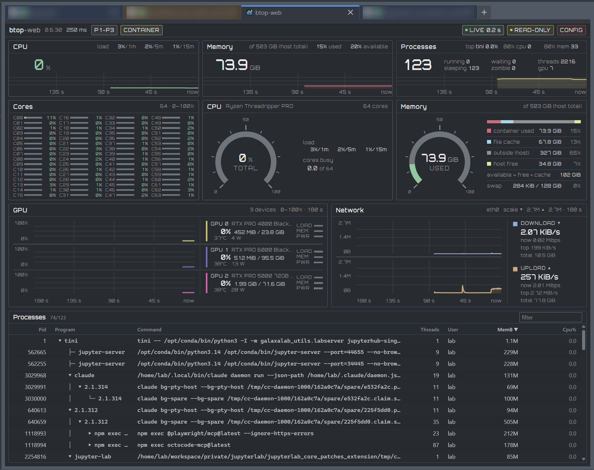

# btop-web

[](https://github.com/stellarshenson/btop-web/actions/workflows/ci.yml)

[](LICENSE)
[](rust-toolchain.toml)
[](https://kolomolo.com)
[](https://www.paypal.com/donate/?hosted_button_id=B4KPBJDLLXTSA)

btop-web 1.0.2 is a Rust web port of btop 1.3.0 that serves its system telemetry to a browser with a responsive design.

## Overview

btop-web reads the same `/proc`, `/sys` and device interfaces as btop and computes every value with btop's source, formula, units, rounding and field name. The page is rendered on the server with Askama and updated over SSE with htmx: no single-page application. The HTML page is the only UI; a newline-delimited JSON stream carries the same frames for agents and the companion client.



*The owner's page: CPU, memory, processes, cores, gauges, GPU and network in one viewport, with the LIVE sample age and the READ-ONLY guard in the top bar.*

## What it shows

The page holds ten panels in four bands, with the network shown once.

- **CPU** - load average, total utilisation and frequency
- **Memory** - used, reclaimable, other, free, and free + reclaimable; swap; the same values on a gauge
- **Processes** - running, sleeping, waiting, zombie, threads, GPU processes and the top process
- **Cores** - one row per core, with its usage
- **GPU** - per-GPU load, VRAM, power and temperature; NVIDIA through NVML, AMD through DRM sysfs
- **Network** - download and upload rate, totals and history, one lane per direction
- **Storage** - used and free space per mount, with IO activity
- **Process table** - views `top`, `all` and `tree`; sortable and filterable; a CPU history on active rows; a click on a row opens its popup with CPU, memory and GPU plots, its figures and the whole command line

Across the page:

- **Plots** - server-built SVG histories over a 1 s EMA, scrolling with the samples
- **Readouts** - gauge numbers on the gauge axis; every other live value reserves its widest form; every stat shows value, unit and source on hover
- **Display** - ten themes, each with a light and a dark form, mode auto/light/dark, and a config menu

A metric the collector cannot read renders as `unavailable`, never as zero.

## Performance

btop-web is optimised for performance, and it delivers.

- **One sampler** - one collection tick feeds every connected client; the fragments are rendered once and each stream sends the held text, so a viewer adds no render work (`collector/mod.rs`)
- **Server tick cost** - 4.2 ms of CPU per tick: 1.01 s of utime+stime from `/proc/<pid>/stat` over 240 `event: cpu` frames counted on one SSE stream in 60 s
- **Browser tab cost** - 11.8 s of renderer CPU over 60 s, 20% of one core, from the renderer process's utime+stime at 1440x900 in headless Chromium
- **Frame rate** - 60 frames per second, 3600 `requestAnimationFrame` callbacks in the same 60 s, from a counter installed before the page scripts
- **Longest main-thread task** - under 50 ms: a longtask PerformanceObserver reports none over the same 60 s
- **Requests after load** - one, the `/events` SSE stream, with no polling request in 60 s, from the browser's request log
- **Idle** - 0.00 s of server CPU and zero voluntary context switches summed over all threads in 60 s with no viewer, from `/proc/<pid>/stat` and `/proc/<pid>/task/*/status`; the sampler drops its timer at the `Wake::idle` gate and waits on a watch change (`collector/mod.rs`)

## Quick start

### Container

`make docker` builds the image locally as `btop-web:dev`. The Docker workflow publishes the release image to `ghcr.io/stellarshenson/btop-web` as `1.0.2` and `1.0`.

```sh
make docker SKIP_VERSION_INCREMENT=1
docker run --rm -p 40290:40290 -e BTOP_WEB_LISTEN=0.0.0.0:40290 btop-web:dev
```

Open <http://127.0.0.1:40290>. A container shows only its own telemetry.

- **Image** - distroless, user `nonroot`, port 40290
- **Bind** - loopback by default; `BTOP_WEB_LISTEN=0.0.0.0:40290` lets the published port reach it
- **Scope** - cgroup v2 CPU, memory, swap, processes, cpuset cores and passed-in GPUs
- **Unavailable** - CPU frequency, temperature, disk IO and network on a shared host namespace
- **Detection** - the log prints `scope=container` with runtime, signal, cgroup and network, or `scope=host`; a CONTAINER chip names them

### Binary

```sh
make env
make build SKIP_VERSION_INCREMENT=1
target/release/btop-web
```

Open <http://127.0.0.1:40290>.

Port 40290 is `btop-web` folded (`v = (v * 256 + byte) mod 64512`) plus 1024; `--config` or `BTOP_WEB_LISTEN` overrides it.

## Configuration

The file uses btop's `key = value` dialect, and `#` starts a comment.

| Key | Default | Variable | Effect |
|---|---|---|---|
| `listen` | `127.0.0.1:40290` | `BTOP_WEB_LISTEN` | bind address |
| `mode` | `standalone` | - | `standalone`, `agent` or `client`; `--agent` and `--client` outrank it |
| `connect` | - | - | `NAME=http://HOST:PORT`, one line per agent; client mode |
| `connect_key` | - | - | `NAME=/PATH` or `NAME=fd:N`, the access key for each client agent |
| `tls_cert`, `tls_key` | generated pair | - | the agent listener's PEM certificate and key; both or neither |
| `theme` | `0` | - | first-paint theme |
| `update_ms` | `250` | `BTOP_WEB_UPDATE_MS` | sample interval in ms; btop's is 2000 |
| `window_s` | `180` | - | chart span in seconds: 60, 120, 180, 300 or 600 |
| `proc_root` | `/proc` | `BTOP_WEB_PROC_ROOT` | collector root |
| `net_floor` | `1` | - | network ceiling floor, Mbit/s |
| `net_fall` | `300` | - | fall window of btop's `graph_max`, s; the plots ignore it: their ceiling stays until a page load |

Unknown keys are ignored; an invalid value stops startup with file and line. Other keys keep btop's names, defaults and validation.

| Flag | Effect |
|---|---|
| `-c, --config PATH` | read PATH after the embedded defaults |
| `-d, --debug`; `-f, --filter TEXT`; `-u, --update MS` | debug log; initial process filter; interval 100 to 86400000 ms |
| `--theme N` | 0 Default, 1 Everforest Medium, 2 Flexoki, 3 Gruvbox, 4 Solarized, 5 Synthwave, 6 Terracotta, 7 Ultraviolet, 8 Cyberpunk, 9 Steel; any other value stops startup |
| `--proc-view VIEW` | `top`, `all` or `tree`; a stored choice outranks it, else `tree` when `proc_tree` is set, else `top`; an invalid or missing value exits 2 |
| `--title TEXT` | tab title, default `btop-web`; blank or missing exits 2 |
| `--readonly` | refuse every mutating request; without it the server is read-write |
| `--agent`; `--client` | telemetry only, or the dashboard from `--connect` agents; the two are exclusive |
| `--connect NAME=URL` | `NAME=http://HOST:PORT`; repeats; client mode; a bad name or URL stops startup |
| `--tls-cert PATH`; `--tls-key PATH`; `--tls-cert-fd N`; `--tls-key-fd N` | the agent listener's PEM pair, from a path or an inherited descriptor; both or neither; without them the agent generates and reuses its own |
| `--access-key-file PATH`; `--access-key-fd N`; `--tls-key-passphrase-env VAR`; `--tls-key-passphrase-file PATH`; `--tls-key-passphrase-fd N`; `--known-agents PATH` | the agent's access key, the encrypted key's passphrase and the client's pin file; a secret value is never a flag value |
| `--default-config`; `-h, --help`; `-v, -V, --version` | print embedded config; usage; version |
| `-b/--boxes`, `-l/--low-color`, `-p/--preset`, `-t/--tty_on`, `--utf-force` | btop's terminal-only flags; exit 2 with `btop-web: <flag> is terminal-only and not applicable` |

### Modes

| Mode | Selected by | Behaviour |
|---|---|---|
| Standalone | no mode flag | samples this host and serves the page |
| Agent | `--agent` | samples this host and serves `/events`, `/events.json`, `/proc/PID`, `/healthz` and `/readyz` over TLS 1.3; no page and no assets |
| Client | `--client --connect NAME=http://HOST:PORT` | samples nothing and serves the page from the named agents over TLS 1.3 |

- **Agent certificate** - generated self-signed, ECDSA P-256, with a random key on the first start at `$XDG_CONFIG_HOME/btop-web/agent.crt` and `agent.key` (mode 0600), reused afterwards; `--tls-cert` and `--tls-key` replace it, and their `-fd` forms read it once from an inherited descriptor; an encrypted PKCS#8 key takes its passphrase from `--tls-key-passphrase-env`, `--tls-key-passphrase-file` or `--tls-key-passphrase-fd`
- **Access key** - an agent requires `Authorization: Bearer KEY` on every request; the key is generated on the first start at `$XDG_CONFIG_HOME/btop-web/access-key` and printed once; a client reads each agent's key from `connect_key = NAME=PATH` or `NAME=fd:N`
- **Pinning** - the client records the agent certificate's `sha256:` fingerprint on the first connect in `$XDG_CONFIG_HOME/btop-web/known_agents` and refuses any other certificate, naming both fingerprints
- **Secrets** - a certificate, key, passphrase or access key is named by a path, a descriptor number or an environment variable name; no secret value is ever a flag
- **Naming** - `NAME` matches `[A-Za-z0-9._-]` and is unique; the top bar names every agent beside its sample age
- **Selection** - the first configured agent is selected; a chip switches the page with `/?agent=NAME`, and an unknown name answers 404
- **State** - an agent that stops answering reads `unavailable` in its chip, with its last frames held for the page's STALE mark; never zeros
- **Streams** - one upstream connection per agent, shared by every viewer: two browsers cost one collection per agent tick, not one per viewer

### Config menu

CONFIG opens seven pages: general, cpu, gpu, mem, net, proc and layout.

- **Display options** - theme, mode, pause, motion, GPU, process view, tree depth, sort and layout; stored per browser; a layout reset
- **Server options** - 41 keys; each option is a form, validated and applied in two ticks
- **`--readonly`** - the options show as text and every mutating request gets 403
- **File write** - one line rewritten in `$XDG_CONFIG_HOME/btop-web/btop-web.conf`, or `~/.config/btop-web/btop-web.conf` when unset; a temp file and a rename; without a resolvable home a change ends at restart
- **Origin** - a mismatched `Origin` gets 403
- **btop file** - `btop.conf` is the baseline and is never written
- **Precedence** - `-u`, `--theme`, `--proc-view` and `BTOP_WEB_*` outrank both files

## Endpoints

The page is HTML rendered by Askama and updated with SSE fragments consumed by htmx; there is no SPA. Agents and the companion client read the same frames as newline-delimited JSON.

| Request | Response |
|---|---|
| `GET /` | dashboard page; client mode `/?agent=NAME` selects the agent |
| `GET /events` | SSE: `cpu`, `mem`, `net`, `proc`, `gpu`, five per snapshot; client mode `/events?agent=NAME` relays that agent's fragments |
| `GET /events.json` | newline-delimited JSON: one document per frame, from the same snapshot `/events` renders, at the same interval; client mode 404, agent mode behind the access key |
| `GET /events.json?once=1` | the newest frame as one document, then close; the top bar's copy button reads it |
| `GET /agents?agent=NAME` | client mode: the agent strip fragment for the one-second htmx poll; 404 in the server modes |
| `POST /config` | one option as HTML |
| `GET /proc/PID` | the process popup's HTML body for a pid the table lists, else 404; a request keeps that pid's rings for the next five slow passes |
| `GET /healthz` | `ok` |
| `GET /readyz` | 200 `ready` once the listener serves |
| `GET /assets/*` | CSS, JavaScript, htmx and icon; sha256 `ETag`, `Cache-Control: no-cache`, 304 on an `If-None-Match` match |

One `/events.json` line carries the whole frame. Units sit in the field suffix: `_pct` is percent 0-100, `_bytes` bytes, `_rate` bytes per second, `_ms` milliseconds, `_mhz` MHz, `_c` degrees Celsius, `_w` watts and `_seconds` seconds. A value the collector could not read is `null`, never zero. `proc` and its plot change at the process refresh period, named by `slow_seq`. The schema below lists keys in place of values.

```json
{
  "events": ["cpu", "mem", "net", "proc", "gpu"],
  "update_ms": 250, "window_ms": 180000, "slow_ms": 1000, "slow_seq": 7,
  "container": false,
  "cpu": {
    "total_pct", "gauge_pct", "cores": [{"name", "usage_pct", "smoothed_pct"}],
    "frequency_mhz", "load_avg": [1m, 5m, 15m], "load_scale", "temperature_c",
    "battery_pct", "name", "cpu_hz", "fields": {btop's ten /proc/stat fields},
    "core_temperatures_c", "temperature_max_c", "battery_seconds",
    "battery_status", "effective_cpus", "pressure_pct"
  },
  "mem": {
    "ram_total", "ram_used", "ram_free", "ram_available", "ram_cache",
    "ram_other", "ram_other_cache", "ram_limit", "ram_percent", "gauge_pct",
    "ram_free_percent", "ram_available_percent", "ram_cache_percent",
    "ram_other_percent", "ram_other_cache_percent",
    "swap_total", "swap_used", "swap_free", "swap_percent", "swap_free_percent",
    "has_swap", "swap_enabled",
    "disks": [{"name", "mount", "dev", "fstype", "used", "total", "free",
    "used_percent", "free_percent", "io_read", "io_write", "io_activity"}]
  },
  "net": {
    "interfaces": [{"name", "ip", "ipv4", "ipv6", "connected", "down_rate",
    "up_rate", "total_down", "total_up", "top_down", "top_up"}],
    "selected_iface", "total_down", "total_up", "graph_max_down", "graph_max_up",
    "link": {"speed_mbps", "duplex", "operstate", "errors", "drops"}
  },
  "proc": {
    "total", "running", "sleeping", "waiting", "zombie", "threads", "top",
    "cpu_80", "mem_80", "chart_max",
    "entries": [{"pid", "name", "user", "cpu_pct", "cpu_c", "mem_bytes",
    "ppid", "threads", "nice", "depth", "state", "command", "sum"}]
  },
  "gpu": {
    "devices": [{"name", "utilization_pct", "memory_utilization_pct",
    "vram_used", "vram_total", "power_w", "power_max_w", "power_percent",
    "temperature_c", "temperature_max_c", "gpu_clock_mhz", "memory_clock_mhz",
    "pstate", "pcie_tx", "pcie_rx"}],
    "average_utilization_pct", "vram_percent", "power_percent",
    "process_count", "process_unreadable"
  },
  "plots": {
    "cpu": [{"line", "area", "width", "height", "max"}],
    "mem": [{"line", "area", "width", "height", "max"}],
    "net": [download, upload],
    "proc": [{"line", "area", "width", "height", "max"}],
    "gpu": [one per device, in node order]
  }
}
```

`plots` carries the SVG paths the page draws, in that plot's viewBox: `line` and `area` are the PCHIP paths, `width` and `height` the box and `max` the y ceiling (the floor is 0). A network `max` only rises, and only a page load lowers it; `graph_max_down` and `graph_max_up` are btop's own ceilings, which fall after `net_fall` s. They are the same server-drawn curves `/events` sends, so a consumer draws no second series.

## Companion Python client

`btop-web-client` reads `/events.json` on the Python standard library alone. `frames()` yields one parsed frame per line, and the CLI of the same name prints one frame, or every frame with `--follow`, as JSON lines. `btop-web-client --help` is the reference for its flags, output and exit codes.

```python
from btop_web_client import frames

# A standalone server: no key and no pin.
for frame in frames("http://127.0.0.1:40290"):
    print(frame["cpu"]["total_pct"])

# An agent: the path of its access key file and the fingerprint of its certificate.
stream = frames("https://host:40290", key_file="/keys/access-key", pin="sha256:<64 hex digits>")
```

- **Install** - `pip install .` from a clone; the `pyproject.toml` at the root builds this client, not the server
- **Agent** - an `https://` URL needs a pin: the `sha256:` fingerprint in the agent's `agent TLS certificate` log line. The client checks it before it sends the key and refuses any other certificate, naming both fingerprints
- **Reconnect** - `frames()` and the CLI stop when the stream closes; a new call gets the next frame
- **Skill** - the agent skill is `.agents/skills/btop-web-client/SKILL.md`; the wheel installs it at `<sys.prefix>/share/jupyter/agents/skills/btop-web-client/`, outside the Python package

No agent reads the installed directory, so link the skill. After `pip install`, with the Python that holds the package:

```bash
mkdir -p ~/.agents/skills && ln -s "$(python -c 'import sys; print(sys.prefix)')/share/jupyter/agents/skills/btop-web-client" ~/.agents/skills/btop-web-client
```

From a clone:

```bash
ln -s "$PWD/.agents/skills/btop-web-client" ~/.claude/skills/btop-web-client
```

## Development

Build commands and gates; `make help` lists all of them.

| Command | Effect |
|---|---|
| `make env`, `make tools` | install the pinned Rust 1.99.1 toolchain, rustfmt and clippy; add cargo-deny, cargo-llvm-cov, cargo-release and cargo-edit |
| `make build` | release binary at `target/release/btop-web`; bumps the patch version first, `SKIP_VERSION_INCREMENT=1` skips the bump |
| `make run` | serve from the source tree at 127.0.0.1:40290; bumps the patch version first |
| `make build-static` | static glibc binary at `target/x86_64-unknown-linux-gnu/release/btop-web`; `STRIP=1` strips it |
| `make fmt-check`, `make clippy`, `make test`, `make ci` | rustfmt check; clippy with `-D warnings`; tests; all three |
| `make test-client` | the browser tests; needs python3 with Playwright and its chromium, so `make ci` leaves them out |
| `make test-python` | build the Python client with `python -m build` and test its wheel against this build's server, in a venv under `target/`; needs PyPI, so `make ci` leaves it out |
| `make deny` | cargo-deny: advisories, licences, bans and sources |
| `make coverage` | cargo-llvm-cov summary; skipped when the tool is absent |
| `make sbom` | regenerate `sbom.cdx.json` offline from `Cargo.lock` and the crate manifests |
| `make doctor` | report the pinned and active toolchain and which dev tools are present |
| `make version`, `make upgrade`, `make clean` | workspace version; cargo upgrade; cargo clean |
| `make release LEVEL=patch` | cargo-release dry run; `EXECUTE=1` acts; `LEVEL=none` refuses |

- **Tests** - `make ci` runs the suite: library tests, HTTP route tests, end-to-end tests that boot the binary against recorded `/proc` and `/sys` trees, TLS tests, theme contrast tests, font tests and performance tests
- **Fixtures** - collector tests read recorded `/proc` and `/sys` trees through `BTOP_WEB_PROC_ROOT`; the end-to-end tests set it too
- **CI** - ubuntu-latest runs `make ci`, `make deny`, llvm-cov and a Docker build; zizmor scans the workflows
- **AMD** - DRM sysfs by default; `FEATURES=rocm` adds the ROCm SMI path and needs `librocm_smi64` and libclang
- **Static build** - the NVIDIA panel needs a host glibc equal to the build host's; NVML loads at runtime

## Repository layout

The crate holds the collectors, routes, templates and assets; the support files sit beside it.

| Path | Contents |
|---|---|
| `crates/btop-web/src/collector/` | one module per btop collector, each recording btop's file, function, formula, units and period |
| `crates/btop-web/src/routes/` | page, SSE, agent strip, config and health handlers |
| `crates/btop-web/templates/` | Askama page and SSE partials |
| `crates/btop-web/assets/` | stylesheet, JavaScript, vendored htmx, icon and fonts |
| `crates/btop-web/themes/` | eight light/dark theme pairs; four are adapted from btop, four are btop-web's own |
| `crates/btop-web/config/btop-web.conf` | embedded default configuration |
| `crates/btop-web/tests/fixtures/` | recorded `/proc` and `/sys` trees |
| `python/`, `pyproject.toml` | the companion Python client and its tests |
| `.agents/skills/btop-web-client/` | the client's agent skill |
| `docs/design/` | design concepts and the screenshot |
| `scripts/` | font and SBOM scripts |

## Exposure

> [!WARNING]
> btop-web has no authentication for the page and binds loopback by default. The page shows process names, command lines, users and endpoints. Remote access needs a TLS proxy with access control. By default anyone who reaches the page can change options and the btop-web.conf file; `--readonly` refuses those changes but adds no authentication. Agent-to-client traffic carries TLS 1.3 and an access key; a viewer of the page carries neither.

## Licence and attribution

MIT ([LICENSE](LICENSE)). Borrowed parts keep their own licences and are listed in [NOTICE.md](NOTICE.md):

- **btop** - Aristocratos and contributors, Apache-2.0; eight theme files in `crates/btop-web/themes/` are adapted from its `themes/`
- **htmx** - 2.0.11 and htmx-ext-sse 2.2.2, BSD-2-Clause; `crates/btop-web/assets/htmx.min.js` and `htmx-sse.min.js`
- **GalaxaLabsTron Narrow** - OFL 1.1, derived from Orbitron; `crates/btop-web/assets/fonts/`
