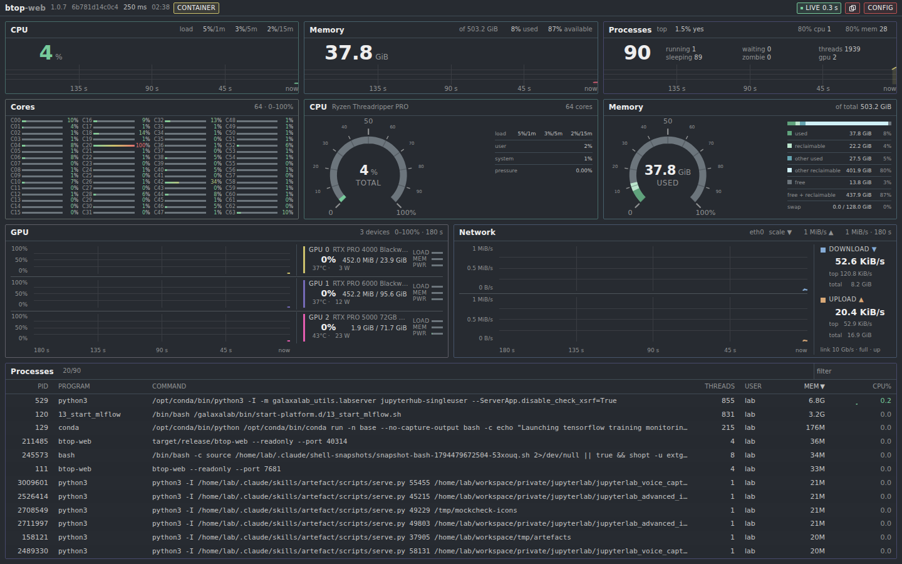

# btop-web

[](https://github.com/stellarshenson/btop-web/actions/workflows/ci.yml)

[](https://crates.io/crates/btop-web)
[](https://github.com/stellarshenson/btop-web/blob/main/LICENSE)
[](https://github.com/stellarshenson/btop-web/blob/main/rust-toolchain.toml)
[](https://kolomolo.com)
[](https://www.paypal.com/donate/?hosted_button_id=B4KPBJDLLXTSA)

btop-web is for live monitoring of critical systems, as btop is, but in a web browser.

*btop-web lists every process that uses your CPU, and when your browser runs on the same machine, the btop-web tab is one of them.*



CONFIG sets the number effect for every live value, the CPU gauge readout included - none, spring up, motion blur, odometer or spring blur - and a positive CPU share never reads 0%.

## Install

From crates.io:

```sh
cargo install btop-web
```

From a clone, the binary lands at `target/release/btop-web`:

```sh
make env
make build SKIP_VERSION_INCREMENT=1
```

The Docker workflow publishes the release image to `ghcr.io/stellarshenson/btop-web` as `1.0.7` and `1.0`; [Container](https://github.com/stellarshenson/btop-web/blob/main/docs/usage.md#container) builds and runs the image.

## Run

```sh
btop-web
```

Open <http://127.0.0.1:40290>.

| Flag | Effect |
|---|---|
| `--port PORT` | listening port, 0 for a kernel-chosen port; default 40290 |
| `--tls-cert PATH`, `--tls-key PATH` | serve the page over TLS 1.3 with this PEM certificate and key; both or neither; without them the page is plain HTTP |
| `--readonly` | refuse every mutating request; without it the server is read-write |

`btop-web --help` lists every flag. [docs/usage.md](https://github.com/stellarshenson/btop-web/blob/main/docs/usage.md) holds the rest: configuration, modes, the config menu, endpoints and the JSON schema, the Python client, performance, development and the repository layout.

> [!WARNING]
> btop-web has no authentication for the page, which shows process names, command lines and users, so keep it on loopback, its default, or behind access control; [Exposure](https://github.com/stellarshenson/btop-web/blob/main/docs/usage.md#exposure) has the detail.

## Licence and attribution

MIT ([LICENSE](https://github.com/stellarshenson/btop-web/blob/main/LICENSE)). Borrowed parts keep their own licences and are listed in [NOTICE.md](https://github.com/stellarshenson/btop-web/blob/main/NOTICE.md):

- **btop** - Aristocratos and contributors, Apache-2.0; eight theme files in `crates/btop-web/themes/` are adapted from its `themes/`
- **htmx** - 2.0.11 and htmx-ext-sse 2.2.2, BSD-2-Clause; `crates/btop-web/assets/htmx.min.js` and `htmx-sse.min.js`
- **GalaxaLabsTron Narrow** - OFL 1.1, derived from Orbitron; `crates/btop-web/assets/fonts/`
